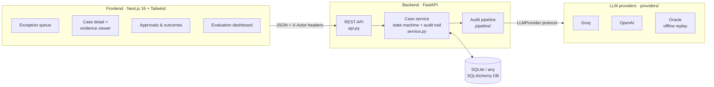
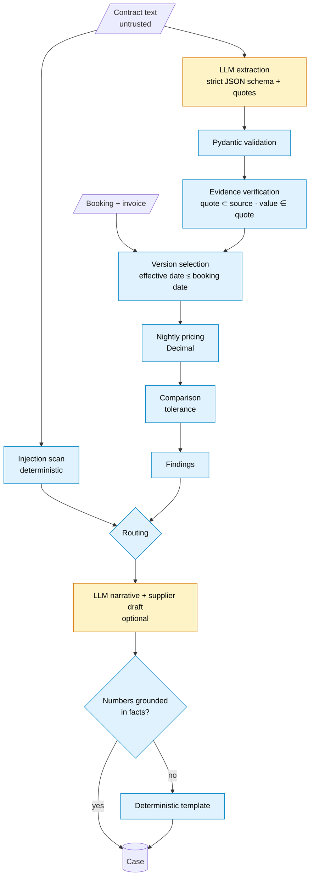
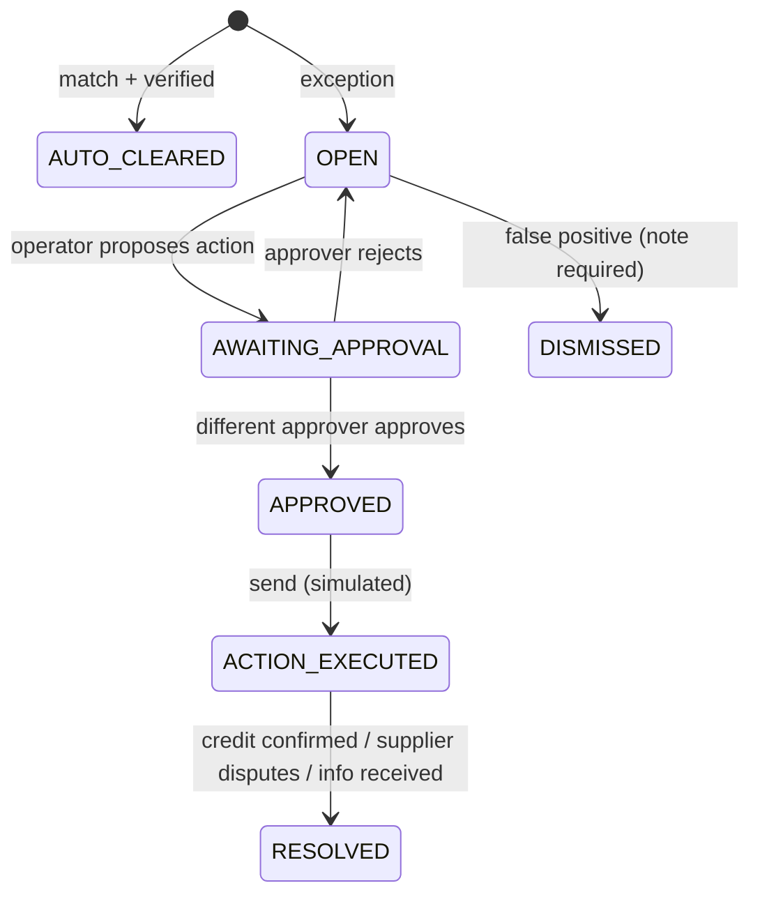

# TripSignal: Contract Rate Assurance Agent

> **Find hotel overcharges before the dispute window closes.** TripSignal audits every booking and supplier invoice against the contract version that was actually in force, explains each discrepancy using verbatim contract evidence, and keeps a human in charge of every supplier action.


Built as proof of work for **Flyo AI's AI Engineering Intern** role. All data is synthetic.

🎥 **Demo video:** [`recordings/tripsignal-full-demo.webm`](recordings/tripsignal-full-demo.webm), a walkthrough of every feature.

---

## Contents
- [Why TripSignal](#why-tripsignal)
- [Features](#features)
- [Architecture](#architecture)
- [Quick start](#quick-start)
- [Using a real LLM](#using-a-real-llm-groq--openai)
- [Evaluation](#evaluation)
- [API](#api)
- [Project layout](#project-layout)
- [Testing](#testing)
- [Troubleshooting](#troubleshooting)
- [Further reading](#further-reading)

---

## Why TripSignal

Travel companies sign hotel contracts that include seasonal rates, amendments, and clauses for cancellations, no-shows, early departures and upgrades. Supplier invoices often drift from those terms, and every billing dispute window that passes is money lost.

Flyo's Contract Agent digitizes contracts. **TripSignal takes the next step and uses those contract terms to find and recover overcharges.** See [docs/PRODUCT_RESEARCH.md](docs/PRODUCT_RESEARCH.md).

### Core principle: *the LLM reads; code decides*

| The LLM does | Deterministic, unit-tested code does |
|---|---|
| Extracts rate rows, effective dates, and clauses, each with a **verbatim quote** | Checks that every quote, and every number in it, appears in the source |
| Writes optional explanations and supplier emails | Chooses the contract version, prices each night, compares amounts, routes the case |
| | Runs the action state machine and the four-eyes approval |
| | Rejects any LLM narrative that cites a number not found in the facts |

The model never computes an amount or decides a route.

---

## Features

**Auditing**
- **Version-aware pricing:** picks the contract and amendments in force on the booking date, then prices night by night using `Decimal`.
- **Traveller-flow checks:** what happened to the traveller decides which nights are billable, and each case follows the clause that governs it (see below).
- **Evidence verification:** an unverified quote can never lead to an auto-clear.
- **Safe abstention:** if evidence is missing, conflicting, or unverified, no amount is calculated and the case is escalated.
- **Prompt-injection defence:** contract text and booking notes are treated as untrusted data and scanned. Flagged cases cannot be auto-cleared.

**Case routing**

| Route | When |
|---|---|
| `AUTO_CLEAR` | Within tolerance and all evidence verified |
| `SUPPLIER_QUERY` | A verified overcharge |
| `REQUEST_INFO` | A required booking field, contract rate, or governing clause (e.g. no-show terms) is missing |
| `ESCALATE` | Injection, conflicting amendments, unknown room, currency mismatch, unverified evidence… |

**Traveller flow**

A booking is audited on what actually happened to the traveller, not just on what was booked:

| What happened | Billable nights | Governing terms | If the clause is missing |
|---|---|---|---|
| Stayed as booked | every booked night | season rates on the booking date | – |
| Cancelled | none if inside the free window, else the first *N* nights | cancellation clause | `REQUEST_INFO` |
| **No-show** | first *N* nights, or the full stay | no-show clause (may share the cancellation sentence; an amendment can change it) | `REQUEST_INFO`. Never inferred from the cancellation terms |
| **Early departure** | nights stayed + penalty nights, capped at the nights left unused | early-departure clause | `REQUEST_INFO` |
| **Extension** | booked nights + extension nights | extension nights use the terms **in force when the extension was agreed**, so they can fall under a newer amendment than the original nights | `REQUEST_INFO` if the agreement date is missing |
| **Hotel-initiated upgrade** | booked room's rate if upgrades are complimentary, else the rate of the room occupied | upgrade clause | `REQUEST_INFO` |
| **Guest-requested upgrade** | rate of the room occupied | season rates | `REQUEST_INFO` if the reason is not recorded |

These combine, for example a complimentary upgrade plus an early departure. Each night in the case view is labelled with its basis (stayed, extension, penalty), and the clauses that decided it are quoted in the supplier email and highlighted in the document viewer. Contradictory records, such as a no-show that also has a departure date, are sent back for information rather than guessed at.

**Operator workflow (UI)**
- An **exception queue** with KPIs (open overcharges, disputes due within 7 days, recorded credits), plus route tabs, filters (including by traveller-flow event), and search.
- A **case view** that shows charged vs. contracted amounts and a per-night table. Clicking a night or a finding highlights its evidence in the **source document viewer**.
- **Four-eyes approval:** the operator proposes, and a *different* approver approves or rejects. Sending is **simulated**.
- **Outcomes:** credit confirmed (approvers only, capped at the detected difference), supplier disputes the charge, info received, or dismissed as a false positive (a note is required).
- A full **audit trail** for every case, an **Evaluation** dashboard, and a "How it works" page.
- Roles: Operator, Approver, Finance approver, and read-only Guest.

---

## Architecture

### System overview



### Audit pipeline


<sub>🟨 LLM step · 🟦 deterministic, unit-tested step</sub>

### Case lifecycle (human in the loop)



### Components

| Module | Responsibility | LLM? |
|---|---|---|
| `config.py` | Settings from env; validates provider credentials at startup | – |
| `providers/` | `LLMProvider` protocol; Groq, OpenAI (official SDKs), Oracle, scripted test provider; timeouts, bounded retries, `retry-after`, fallback provider, usage and cost | – |
| `domain.py` | Pydantic schemas for contracts, bookings, findings, routes | – |
| `pipeline/injection.py` | Pattern scan for instruction-like text | no |
| `pipeline/extraction.py` | Prompt, strict schema, validation, evidence verification | **yes** |
| `pipeline/engine.py` | Version selection, nightly pricing, traveller flow (cancellation, no-show, early departure, extension, upgrade), findings, routing | no |
| `pipeline/narrative.py` | Explanation and supplier email; rejects ungrounded numbers | **yes** (optional) |
| `pipeline/run.py` | Orchestrates the pipeline end to end | no |
| `service.py` | Case lifecycle, action state machine, four-eyes rule, audit trail | no |
| `db.py`, `api.py` | SQLAlchemy persistence and FastAPI routes | – |
| `evals/` | Seeded dataset generator, runner, comparison | – |

### Design trade-offs
- **No vector DB, queue, or agent framework.** Each case uses one hotel's small set of contract versions, so there is nothing to retrieve. The workflow is a linear typed pipeline with one human checkpoint.
- **Defence in depth against injection:** delimited untrusted input, a model with no tools, a deterministic scanner, and a block on auto-clearing flagged cases.
- **SQLite by default**, with Postgres one `DATABASE_URL` change away.
- **Oracle provider** for offline demos and CI. It is always labelled `oracle` and is never presented as model output.

More detail: [docs/ARCHITECTURE.md](docs/ARCHITECTURE.md) · [docs/DECISIONS.md](docs/DECISIONS.md)

---

## Quick start

### Prerequisites
Python 3.12+ and Node.js 20+ (or Docker).

### Option A: Docker (one command)
```bash
docker compose up --build
```
UI: http://localhost:3000 · API: http://localhost:8000

### Option B: Local (offline demo, no API keys)

**Backend**
```powershell
cd backend
python -m venv .venv
.venv\Scripts\Activate.ps1            # macOS/Linux: source .venv/bin/activate
pip install -e ".[dev]"
python -m app.seed --reset            # 10 contracts + 133 bookings
$env:AS_OF_DATE = "2026-10-20"        # bash: export AS_OF_DATE=2026-10-20
uvicorn app.main:app --port 8000
```

**Frontend** (new terminal)
```bash
cd frontend
npm install
npm run dev                           # http://localhost:3000
```

In demo mode (`AI_PROVIDER=oracle`), extraction replays the dataset's ground truth, and the UI shows a **"Demo · oracle extraction"** label. No model is called.

---

## Using a real LLM (Groq / OpenAI)

Copy `.env.example` to `backend/.env` and set:

| Variable | Meaning |
|---|---|
| `AI_PROVIDER` | `oracle` (default), `groq`, or `openai` |
| `GROQ_API_KEY` / `OPENAI_API_KEY` | Required for the chosen provider. Startup fails with a clear message if it is missing |
| `GROQ_MODEL` | Default `openai/gpt-oss-120b` (supports strict json_schema) |
| `OPENAI_MODEL` | Default `gpt-6.1-sol` |
| `FALLBACK_PROVIDER` | Optional. Used once on timeout, 429, 5xx, auth, or quota errors |
| `LLM_NARRATIVES` | Enables LLM-written explanations. A draft is rejected if it cites a number not in the facts |
| `AS_OF_DATE` | Fixes "today" for reproducible deadline countdowns |

Switching providers is configuration only. Business logic depends on a single `LLMProvider` protocol.

---

## Evaluation

**133 synthetic cases across 20 categories:** matches, overcharges, undercharges, rounding traps, season boundaries, amendments, conflicting amendments, OCR-damaged rates, prompt injection (in contracts and in booking notes), currency mismatches, missing fields, unknown room types, missing contracts, cancellations, multi-room bookings, and the traveller flow: no-shows, early departures, extensions, room changes, and combinations of them.

**Oracle (engine only), 2026-10-26, 133 cases:** 100% route, finding-code and amount accuracy, 0 unsafe auto-clears, 100% stay-change terms accuracy.

**Groq results below are from 2026-10-20, on the earlier 102-case dataset** (before the traveller-flow cases and the `extract-v2` prompt). The Groq run has not yet been repeated on the 133-case dataset.

| Metric | Oracle (engine only) | Groq `gpt-oss-120b` + narratives |
|---|---|---|
| Route accuracy | 100% | **100%** |
| Finding-code / amount accuracy | 100% / 100% | **100% / 100%** |
| Unsafe auto-clears | 0 | **0** |
| Rate-row extraction recall (55 rows, 10 docs) | 100% | **100%**, 0 spurious, 100% quotes verified |
| LLM narratives kept / rejected | n/a | 58 / 0 |
| LLM calls · tokens · cost | n/a | 68 · 56k in / 50k out · **≈ $0.04** |
| Mean LLM latency | n/a | 2.3 s |

- Groq **ignored the injected "USD 999.00" rate** and returned `null` for both OCR-damaged rates, as instructed.
- An earlier run hit free-tier 429s and 6 of 10 extractions failed. **All of them failed safely** (escalated, 0 unsafe auto-clears). That run led to honouring `retry-after` (DECISIONS D11).
- **OpenAI has not been evaluated** because the configured key returns `insufficient_quota`.
- **Caveat:** 10 documents in 3 formatting styles is a small extraction sample. These results show the pipeline works, not that it generalizes.

```bash
cd backend
python -m evals.generate                      # regenerate dataset (seeded)
python -m evals.run --provider oracle
python -m evals.run --provider groq           # needs GROQ_API_KEY
python -m evals.run --provider openai --narratives
python -m evals.compare                       # side-by-side table
```
Methodology: [docs/EVALUATION_PLAN.md](docs/EVALUATION_PLAN.md). Results are saved to `backend/evals/results/` and shown in the UI under **Evaluation**.

---

## API

| Method | Path | Notes |
|---|---|---|
| POST | `/api/documents` | Add a contract version. Changed content under an existing id returns 409 |
| POST | `/api/audits` | `{booking, document_ids?}`. Idempotent: the same input returns the same case |
| GET | `/api/cases?route=&status=&severity=&q=` | Exception queue |
| GET | `/api/cases/{id}` | Result, evidence, documents, actions, audit trail |
| POST | `/api/cases/{id}/actions` | Propose an action (operator or approver) |
| POST | `/api/actions/{id}/approve` · `reject` · `execute` | The approver must differ from the proposer. Execute is **simulated** |
| POST | `/api/cases/{id}/outcome` | `CREDIT_CONFIRMED` · `SUPPLIER_DISPUTED` · `INFO_RECEIVED` · `DISMISSED_FALSE_POSITIVE` |

Demo identity is sent via the `X-Actor-Id` and `X-Actor-Role` headers. **This is not real authentication.**

---

## Project layout

```
backend/
  app/pipeline/    injection scan · extraction + verification · engine · narrative · orchestration
  app/providers/   Groq / OpenAI (official SDKs), oracle, scripted test provider
  app/service.py   case lifecycle, state machine, audit trail
  evals/           dataset generator, runner, compare
  tests/           85 tests
frontend/          Next.js 16 + Tailwind: queue, case detail, evidence viewer, approvals, evaluation
docs/              product research, architecture, evaluation plan, decisions, limitations
recordings/        demo video
```

---

## Testing

```bash
cd backend
pytest                    # 85 tests: engine rules, traveller flow, extraction/verification, providers
                          # (mocked SDKs), narrative grounding, API lifecycle, eval regression
ruff check . && mypy app
cd ../frontend && npm run lint && npm run build
```

---

## Troubleshooting

| Symptom | Fix |
|---|---|
| `AI_PROVIDER=openai but OPENAI_API_KEY is not set` | Add the key to `backend/.env`, or use `AI_PROVIDER=oracle` |
| `account quota/credits exhausted` | The key has no credits. This error is not retried by design |
| UI shows **"API offline"** | Start the backend on :8000, or check `NEXT_PUBLIC_API_URL` |
| Empty queue | Run `python -m app.seed` |
| Deadline countdowns look odd | Set `AS_OF_DATE` (the synthetic data is dated 2026–2027) |
| `Activate.ps1` is blocked | Run `Set-ExecutionPolicy -Scope CurrentUser RemoteSigned` |

---

## Further reading
- [Product research](docs/PRODUCT_RESEARCH.md): why this workflow
- [Architecture](docs/ARCHITECTURE.md)
- [Decisions log](docs/DECISIONS.md): D1–D11
- [Evaluation plan](docs/EVALUATION_PLAN.md)
- [Known limitations](docs/LIMITATIONS.md)
